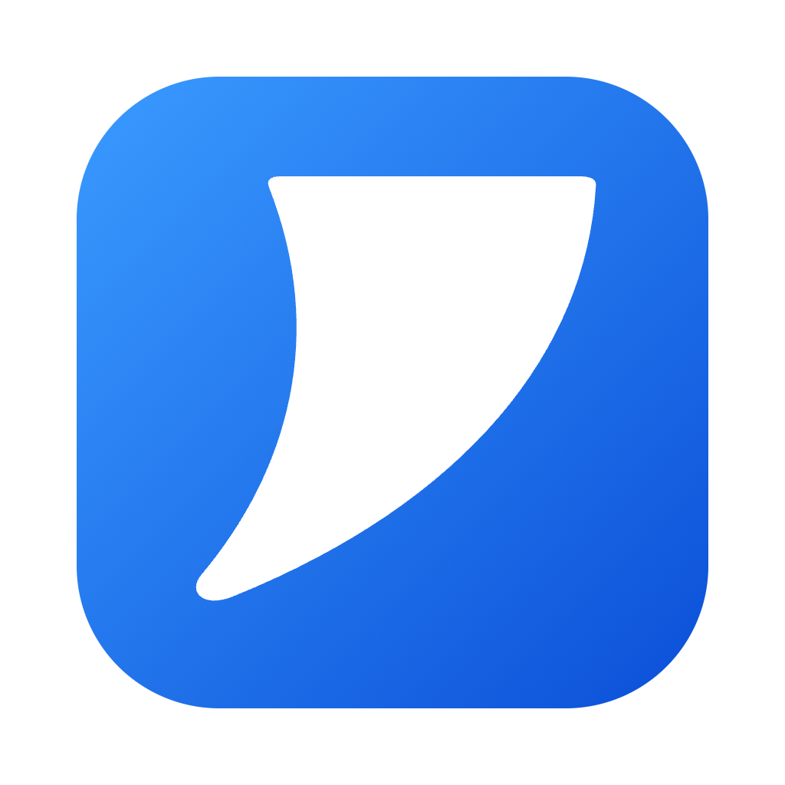

# Surf



Surf is a desktop web browser for macOS, built with Electron. Tabs live in a sidebar, organized into spaces, with folders, split view, a shelf, and AI built in.

## Features

**Tabs and organization**
- Sidebar with favorites, pinned tabs, and today's tabs, which are archived automatically after a while
- Pinned tabs shown as square tiles that glow in each site's color; when a pinned tab has moved to another page, a ↩ badge takes it back to its home page
- Spaces, each with its own color, search engine, and optionally separate logins
- Custom space colors from a color picker, in the space menu and in Settings
- Two-finger swipe on the sidebar to switch spaces
- Folders, split view (up to 4 pages side by side), and drag and drop for everything, with animations when folders open and tabs are added or closed
- Tab switcher: hold ⌃ and press Tab to step through recent tabs as thumbnails
- Live folders that follow an RSS/Atom feed or a GitHub repo's pull requests and issues
- Bookmarks in Library → Bookmarks: folders, search, drag to reorganize, and bookmarks.html import/export (right-click the ★ in the address bar to bookmark a page)
- Profiles: fully separate setups (tabs, logins, settings), each opened as its own Surf window from Surf → Open Profile or Settings → Profiles
- Shelf: a tray above the sidebar's bottom bar for downloads, screenshots, and anything you drop on it (tabs, links, images, text); items can be dragged back out

**Browsing**
- Command bar (⌘T) to open sites, search, jump to tabs, and run actions
- Address bar suggestions from open tabs, history, and live search
- Peek (⇧-click a link) to open a page in a floating card
- Little windows for links opened from other apps
- Reader view, read aloud, find in page, zoom, and swipe and mouse gestures
- Web panels: small web apps docked beside the page
- Media controls in the sidebar for tabs playing audio or video

**Making the web yours**
- Boosts: per-site dark mode, colors, fonts, custom CSS, and zapping elements
- Highlights saved per page, notes, and easels
- Screenshots of the visible area, the full page, or a selection
- Basic Chrome extension support, including install from the Chrome Web Store

**Privacy and security**
- Shields block ads and trackers, with a privacy report
- Private windows
- Password manager encrypted with the macOS Keychain

**AI (Claude)**
- Ask about or summarize the current page, link previews, tab tidying, and smart download names
- Uses a Claude API key, or your own free server. See [server/README.md](server/README.md).

Settings open with ⌘, or from Surf → Settings… in the app menu.

## Getting started

Requires a recent version of [Node.js](https://nodejs.org).

```sh
npm install
npm start
```

## Install

```sh
npm run package
```

This builds `dist/mac-arm64/Surf.app`, which can be copied to `/Applications`. The build is for Apple Silicon only and is unsigned, so on other Macs open it the first time with right-click → Open.

## Keyboard shortcuts

These are the defaults; change any of them in Settings → Keyboard shortcuts.

| Shortcut | Action |
| --- | --- |
| ⌘T | New tab / command bar |
| ⌘L | Edit address |
| ⌘W | Close tab |
| ⇧⌘T | Reopen closed tab |
| ⌘D | Pin / unpin tab |
| ⇧⌘D | Split view |
| ⌘S | Toggle sidebar |
| ⇧⌘C | Copy URL |
| ⌘1–9 | Go to tab |
| ⌃1–9 | Go to space |
| ⌃Tab | Switch tabs (hold ⌃) |
| ⌥⌘N | Little window |
| ⇧⌘2 | Capture to easel |
| ⌘F | Find in page |
| ⌥⌘B | Bookmarks |
| ⌘+ / ⌘− | Zoom in / out (⌘0 resets) |
| ⇧⌘R | Reader view |
| ⇧ over a link | AI link preview |
| Two-finger swipe | Back / forward (on the sidebar: switch space) |
| ⇧⌘N | Private window |
| ⌥⌘C | Compact mode |
| ⇧⌘S | Screenshot |
| ⌥⌘I | Page DevTools |
| Tab after “yt”, “gh”… | Search a site |
| Right-drag ← → ↓ ↓→ | Gestures: back, forward, new tab, close |
| ⌘Y | History |
| ⇧⌘J | Downloads |
| ⌘, | Settings |
| ⇧-click | Open link in Peek |

The same list is in Settings.

## Project layout

```
main.js, main-features.js   Main process: windows, menus, preferences
main/                       Main process: AI, sessions & downloads, screenshots & passwords
renderer.js                 Entry point for the main window
src/                        Renderer modules (tabs, sidebar, shelf, tab switcher, site colors, command bar, …)
index.html, style.css       Main window markup and styles
newtab.html                 New tab page
mini.html, mini.js          Little window
build/                      App icon
server/                     Optional self-hosted AI server setup
```
